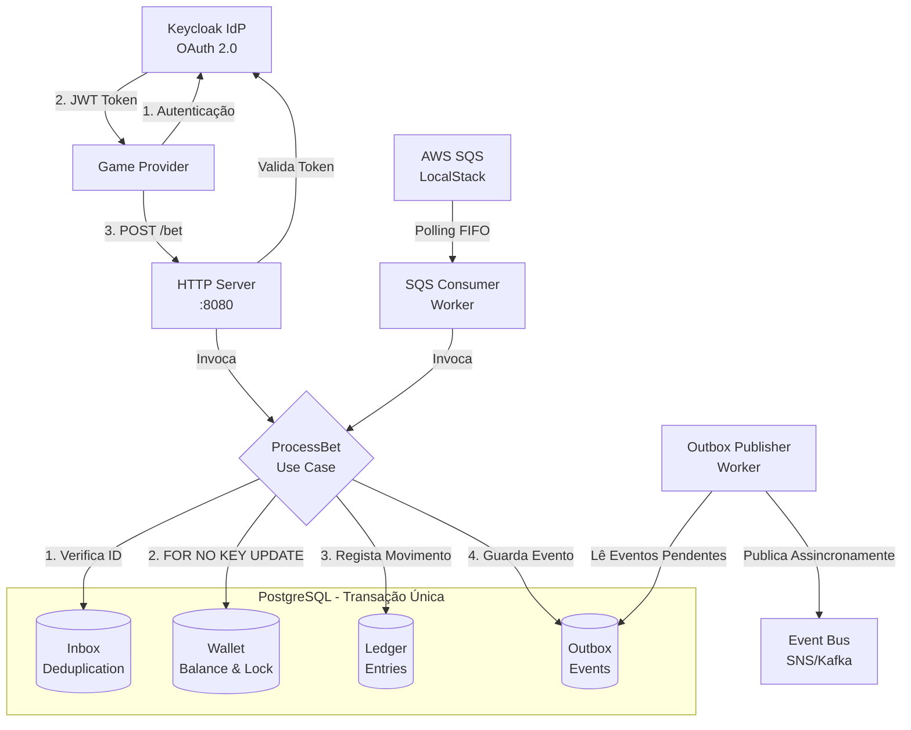

# Jungle Gaming Backend Challenge - Golang

Solução do desafio para processamento distribuído de apostas com alta resiliência e concorrência controlada, construído em Go.

## 🚀 A Minha Jornada neste Projeto

Antes de entrarmos nos detalhes técnicos, gostaria de compartilhar a minha experiência construindo este sistema. Eu sou um desenvolvedor de jogos (Game Dev) habituado a trabalhar diariamente com C# e Unity. Quando me deparei com este desafio, os requisitos eram gigantescos para o meu contexto: construir um sistema distribuído financeiro, lidando com transações ACID, bloqueios de concorrência, filas FIFO na AWS, padrões de Inbox/Outbox e injeção de dependências estrita.

Nunca tinha escrito uma linha em **Go**, nunca tinha usado **Docker/Docker Compose**, não conhecia o **AWS SQS** nem o LocalStack, não sabia configurar o **Keycloak (IdP)** e nunca tinha escrito testes em Go. Tudo era novidade.

Para não me sentir esmagado pela complexidade, decidi usar IA (o Gemini do Google) como meu "pair programmer" e mentor. Não pedi para a ferramenta "cuspir" o projeto pronto; em vez disso, pedi para ser guiado passo a passo, etapa por etapa. 
Aprendi na prática sobre:
- **Go Puro:** Como structs substituem classes, como tratar erros sem `try/catch` e como a tipagem estrita ajuda no desenvolvimento.
- **Transações Atômicas e Concorrência:** O porquê de um `UPDATE ... FOR NO KEY UPDATE` ser essencial quando duas apostas chegam no exato mesmo milissegundo.
- **Padrões de Resiliência:** Entendi na pele por que a AWS pode entregar a mesma mensagem duas vezes e como a tabela `inbox` nos salva disso.
- **Infraestrutura como Código:** Como subir todo um ecossistema com um único comando no Docker Compose.

Foi uma jornada de sair totalmente da zona de conforto (do loop visual de um jogo para o mundo silencioso de *workers* de background e logs de terminal), mas que me deu uma base incrível de engenharia de software backend.

## Requisitos

- [Go 1.20+](https://go.dev/dl/)
- [Docker](https://www.docker.com/) e [Docker Compose](https://docs.docker.com/compose/)

## Configuração

1. Clone o repositório.
2. Existe um ficheiro de exemplo `.env.example` na raiz do projeto contendo as variáveis padrão utilizadas.

## Inicialização do Ambiente e Infraestrutura

A aplicação utiliza Docker Compose para subir o PostgreSQL, o Keycloak (provisionado) e o AWS LocalStack.

**1. Subir dependências:**
\`\`\`bash
docker compose up -d
\`\`\`

**2. Provisionar a fila SQS (LocalStack):**
Execute o utilitário de *setup* das filas SQS FIFO e DLQ:
\`\`\`bash
go run cmd/sqs-setup/main.go
\`\`\`

**3. Aplicar as Migrations do banco de dados:**
Execute o utilitário que criará as tabelas do PostgreSQL:
\`\`\`bash
go run cmd/migrate/main.go
\`\`\`

## Iniciar a Aplicação Principal

\`\`\`bash
go run cmd/api/main.go
\`\`\`

Isto iniciará:
- O servidor HTTP na porta `:8080`
- O Worker do AWS SQS
- O Worker do Outbox Publisher

## Autenticação

A aplicação está protegida por Token JWT gerado pelo Keycloak. O ambiente Docker Compose está configurado com um *realm* automático.

**Gerar o Token:**
\`\`\`bash
curl -X POST http://localhost:8081/realms/betting-realm/protocol/openid-connect/token \
  -H "Content-Type: application/x-www-form-urlencoded" \
  -d "client_id=provider-a" \
  -d "client_secret=super-secret-provider-a" \
  -d "grant_type=client_credentials"
\`\`\`

## Exemplos de Chamadas

### 1. Criar uma Carteira Nova
\`\`\`bash
curl -X POST http://localhost:8080/wallets \
  -H "Authorization: Bearer <SEU_TOKEN>" \
  -H "Content-Type: application/json" \
  -d '{
    "playerId": "jogador-123",
    "initialBalance": { "amount": "100.00", "currency": "BRL" }
  }'
\`\`\`

### 2. Efetuar Aposta
(Adicione uma Chave de Idempotência que será verificada).
\`\`\`bash
curl -X POST http://localhost:8080/bet \
  -H "Authorization: Bearer <SEU_TOKEN>" \
  -H "Content-Type: application/json" \
  -H "Idempotency-Key: bet-001" \
  -d '{
    "wallet_id": "<ID_DA_CARTEIRA_ACIMA>",
    "transaction_id": "tx-001",
    "amount": "25.00",
    "currency": "BRL"
  }'
\`\`\`

## Comandos de Avaliação

Verifique o código localmente:
\`\`\`bash
go vet ./...
go test ./...
go test -race ./...
\`\`\`

## 🏗️ Arquitetura do Sistema

O diagrama abaixo ilustra como os componentes interagem, garantindo que as regras financeiras sejam respeitadas, quer a aposta chegue por HTTP ou por SQS, utilizando uma transação atómica que abrange a carteira, o livro-razão (ledger) e as tabelas de deduplicação e eventos.

